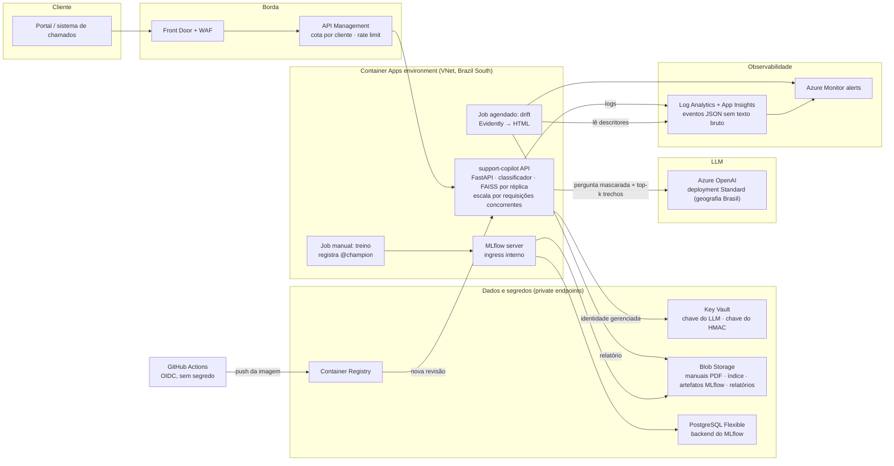

# Arquitetura de nuvem (proposta em Azure)

Proposta de como o Support Copilot rodaria em produção. Nada aqui está implantado: o que existe e
foi testado é a imagem Docker e o `docker compose` deste repositório. Os números de dimensionamento
vêm de medições locais, com o método ao lado de cada um.

**Região:** Brazil South (São Paulo), para manter dados e processamento no Brasil (ver
[`docs/lgpd.md`](lgpd.md), transferência internacional).

## Diagrama

## Componentes e por que cada um

| peça | serviço Azure | papel | por que este |
|---|---|---|---|
| API | **Container Apps** | roda a mesma imagem do `docker compose` (`/predict`, `/chat`, `/ticket`, `/health`) | serverless de contêiner com escala por regra (KEDA) e revisões com divisão de tráfego; não exige operar Kubernetes |
| Imagem | **Container Registry (ACR)** | guarda a imagem versionada pelo commit | o Container Apps puxa com identidade gerenciada, sem senha |
| Segredos | **Key Vault** | chave do LLM e chave do HMAC dos logs | referenciados como segredos do Container Apps via identidade gerenciada; nunca na imagem (hoje um teste já garante que nenhuma chave entra na imagem) |
| Arquivos | **Blob Storage** | manuais PDF, índice FAISS gerado por job, artefatos do MLflow, relatórios do Evidently | barato e versionável (soft delete + versionamento de blob) |
| Tracking | **MLflow em contêiner** + PostgreSQL Flexible + Blob | mesmo MLflow do projeto (versão do `uv.lock`), ingress só interno | mantém o fluxo local idêntico ao de produção; alternativa gerenciada: workspace do Azure ML, que fala o protocolo do MLflow |
| LLM | **Azure OpenAI**, deployment *Standard* (geografia) | gera a resposta a partir dos trechos | o deployment por geografia processa na geografia do recurso; o *Global Standard* pode processar em qualquer região (ver LGPD). Gemini/OpenAI públicos continuam suportados pelo `LLM_PROVIDER` |
| Borda | **Front Door + WAF**, **API Management** | TLS, WAF, cota e rate limit por cliente | protege a cota do LLM: um cliente não esgota o orçamento dos outros |
| Logs | **Log Analytics + Application Insights** | recebe os eventos JSON que a API já escreve (`predict`, `chat`, `ticket`, sem texto bruto) | consulta em KQL; base dos descritores de drift |
| Drift | **Container Apps Job** agendado | roda `support_copilot.drift.report` sobre os descritores do período e publica o HTML no Blob | o mesmo código do repositório, sem servidor ligado o tempo todo |
| Treino | **Container Apps Job** manual | `support_copilot.model.train` contra o MLflow, promove `@champion` | treino leve (TF-IDF + LogReg, ~8 min em CPU); GPU seria desperdício |
| CI/CD | **GitHub Actions** com federação OIDC | lint, testes, build, push no ACR, nova revisão | o CI deste repositório já faz lint, testes e `docker compose up` + smoke test; falta só o passo de deploy |

## Escala

**Regra de escala: requisições HTTP concorrentes, não CPU.** Com um LLM real, quase todo o tempo de
um `/chat` é espera de rede pelo provedor: a CPU da réplica fica ociosa enquanto as requisições se
acumulam. Uma regra por CPU não enxergaria essa carga. O Container Apps calcula a concorrência a
cada 15 s e adiciona réplicas quando ela passa do limite configurado (padrão 10).

| parâmetro | proposta | de onde vem |
|---|---|---|
| tamanho da réplica | 1 vCPU / 2 GiB | a API usa **405 MiB** de memória com modelo + índice carregados, parada e depois de 930 requisições (`docker stats`, Mac M2) |
| réplicas mínimas | **1** | sem escala a zero na API: o primeiro chamado depois de ociosidade pagaria o download da imagem (659 MB comprimida) e a subida (~5 s até `healthy`, medido no D9) |
| réplicas máximas | 10 no início | ajustar pelo Azure Monitor; o gargalo real será a cota do LLM, não a réplica |
| concorrência por réplica | 10 (padrão) | ponto de partida; calibrar com teste de carga contra o LLM real (pendente: sem chave) |

Latência local medida (1 cliente, 300 requisições sequenciais por rota, contêiner no Mac M2, provedor
`fake`, ou seja, **sem** o tempo do LLM real):

| rota | p50 | p95 | p99 |
|---|---|---|---|
| `/predict` | 1,5 ms | 2,0 ms | 3,3 ms |
| `/chat` | 18,0 ms | 32,4 ms | 43,4 ms |
| `/ticket` | 23,8 ms | 38,2 ms | 46,2 ms |

Leitura: classificar e recuperar custa dezenas de milissegundos. Com o LLM real, a latência e o
custo passam a ser do provedor. Por isso a escala vigia concorrência e a borda impõe cota.

## O gargalo do FAISS em memória

Hoje cada réplica carrega o próprio índice FAISS, gerado no `docker build`. Isso é bom para
começar (o contêiner sobe sem rede, testado com `--network none`) e tem limites claros quando o
produto cresce.

| aspecto | hoje (medido) | quando vira problema |
|---|---|---|
| tamanho | 166 trechos, índice de 0,6 MB, vetores de 384 dimensões | os vetores ocupam `n × 384 × 4 bytes` em **cada** réplica: 1 milhão de trechos ≈ 1,5 GB por réplica, só de vetores (conta, não medição) |
| construção | 166 trechos em 25 s no build (inclui carregar o modelo de embeddings) | por extrapolação linear dessa única medida, ~0,15 s por trecho: 100 mil trechos levariam horas, inviável no build ou no startup |
| atualização | trocar o manual exige nova imagem e nova revisão | com manuais atualizados toda semana, cada mudança de documento vira um deploy |
| consistência | o `INGEST_VERSION` entra na chave do cache do índice | durante um rollout, réplicas antigas e novas respondem com índices diferentes; o `/health` deveria expor a versão do índice para isso ser visível |

**Evolução em duas etapas:**

1. **Índice como artefato.** Um job gera o índice a partir dos PDFs no Blob e grava
   `index/<hash do PDF>-<INGEST_VERSION>/`; a réplica baixa no startup. Atualizar o manual deixa de
   exigir build de imagem. Continua um índice por réplica, então serve enquanto o índice couber
   folgado na memória.
2. **Azure AI Search** como banco vetorial gerenciado, fora das réplicas: índice único, atualização
   incremental por documento, filtros por produto e busca híbrida (vetor + palavra-chave). O
   retriever do LangChain troca de `FAISS` para o integrador do AI Search; o limiar de recusa
   precisa ser recalibrado, porque o score muda de escala.

Os filtros por produto atacam o achado mais caro do projeto: no `/ticket`, 223 chamados de outros
produtos foram "respondidos" com o manual do OPNsense ([`findings.md` §7](findings.md)). Filtrar
pelo produto do cliente antes da busca é uma correção de produto, não só de escala.

## Monitoramento em produção

- **Eventos da API** (já implementados, JSON por linha, sem texto do chamado): `predict`, `chat`,
  `ticket`, `validation_error`, `chat_error`, com hash, tamanho, fila, confiança, rota, latência,
  `pii_masked`, `llm_called`, `refusal_reason`.
- **Drift:** o job agendado roda o mesmo relatório do D8 sobre os descritores do período (tamanho,
  palavras, % fora do vocabulário, % não-letras, % não-ASCII) e sobre as saídas do modelo. Limiares
  por coluna vêm de `reports/drift_thresholds.json` (calibrados em 50 divisões A/A).
- **Regra de alerta [PRESCRITO]:** alertar quando **qualquer** saída do modelo (fila, rota,
  confiança) derivar, e não pela regra padrão do Evidently (≥ 50% das colunas). No incidente de
  cobrança a regra padrão disparou em só 8/20 sementes, enquanto as saídas do modelo derivaram em
  20/20 ([`findings.md` §8](findings.md)).
- **Rótulo:** chega quando o chamado é resolvido; o F1 do período entra como métrica separada, porque
  drift não é degradação (a mudança de mix disparou alarme e a acurácia subiu de 0,383 para 0,455).
- **RAG e guardrails:** taxa de recusa, taxa de bloqueio por categoria e `top_score` dos trechos por
  período. Um salto na taxa de bloqueio é sinal de ataque ou de falso positivo novo; os dois pedem
  olhar humano.

## Equivalência AWS e GCP

| função | Azure (proposta) | AWS | GCP |
|---|---|---|---|
| contêiner serverless com autoscaling | Container Apps | ECS on Fargate | Cloud Run |
| jobs agendados | Container Apps Jobs | ECS Scheduled Tasks / AWS Batch | Cloud Run jobs + Cloud Scheduler |
| registro de imagens | Container Registry | ECR | Artifact Registry |
| segredos | Key Vault | Secrets Manager | Secret Manager |
| objetos | Blob Storage | S3 | Cloud Storage |
| banco do MLflow | PostgreSQL Flexible Server | RDS for PostgreSQL | Cloud SQL for PostgreSQL |
| tracking gerenciado (alternativa) | Azure ML (compatível com MLflow) | SageMaker com MLflow gerenciado | Vertex AI Experiments |
| LLM gerenciado | Azure OpenAI | Bedrock | Vertex AI (Gemini) |
| banco vetorial gerenciado | Azure AI Search | OpenSearch Service (vetorial) | Vertex AI Vector Search |
| borda e cota | Front Door + API Management | CloudFront + WAF + API Gateway | Cloud Load Balancing + Cloud Armor + Apigee |
| logs e alertas | Log Analytics, App Insights, Azure Monitor | CloudWatch | Cloud Logging + Cloud Monitoring |
| região no Brasil | Brazil South | sa-east-1 (São Paulo) | southamerica-east1 (São Paulo) |

## Fontes

- Regras de escala do Container Apps (HTTP, cálculo a cada 15 s, padrão 10 concorrentes):
  <https://learn.microsoft.com/azure/container-apps/scale-app>
- Tipos de deployment do Azure OpenAI e local de processamento (Global, Data Zone, Standard por
  geografia): <https://learn.microsoft.com/azure/ai-foundry/openai/how-to/deployment-types>
